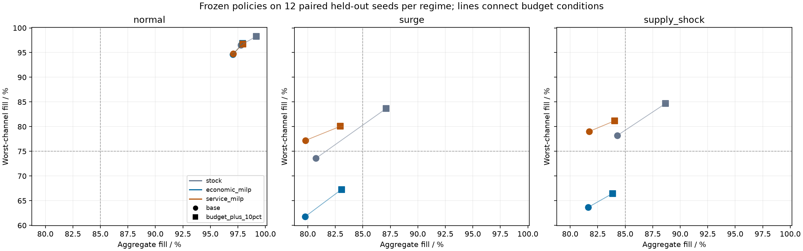
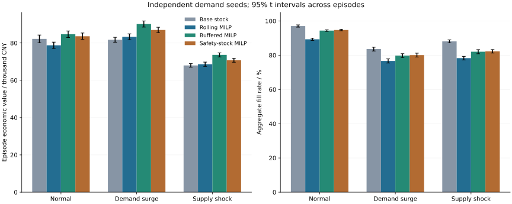
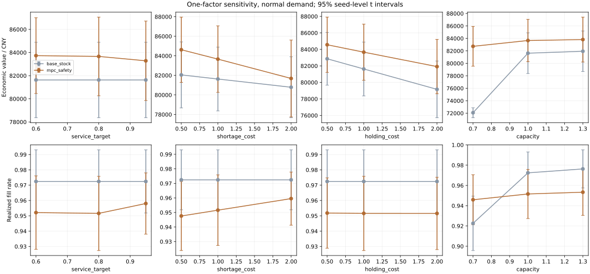

# Inventory Allocation Optimization

**Operations Research & Decision Optimization** · Inventory and service decisions

  

[Portfolio](https://github.com/xsm-math) · [01 Inventory](https://github.com/xsm-math/inventory-allocation) · [02 Credit Risk](https://github.com/xsm-math/Risk-Modeling) · [03 Gold Allocation](https://github.com/xsm-math/invest)

| Project Summary | Rolling replenishment and allocation in a multi-warehouse, multi-channel, multi-SKU network; the flagship optimization study. |
|---|---|
| Research Question | Which controller and procurement resources are justified by a service mandate and budget-access cost? |
| Methods | Rolling MILP, cumulative-service priorities, checked native refinement, validation-frozen decisions and optimistic resource LP bounds. |
| Key Results | With budget +10%, frozen choices change from economic MILP (80%/60% service means) to service-priority MILP (80%/75%) to simple stock (85%/75%). All three confirm on held-out means. Current-budget surge fill is bounded above by 86.54%; strict 90%/80% needs at least 7.13% more budget in a relaxation, without an achievable-service guarantee. |
| Evidence | [Decision conclusions](docs/DECISION_CONCLUSIONS.md), [frozen held-out assessment](results/decision_study/2026-10-27/decision_assessment.csv), [all outcomes](results/decision_study/2026-10-27/test_summary.csv). 108 validation / 216 test synthetic episodes; 12 new test seeds per regime. No general MILP dominance or real savings claim. |



## Core decisions

Service thresholds below are means required in **every** declared regime. Choices
are frozen on validation, use budget +10%, and confirm on 12 new test seeds per
regime at hypothetical facility fees of 0 / 100 / 250 / 500 CNY/day.

| Aggregate / worst-channel mandate | Supported choice | Modeling implication |
|---|---|---|
| 80% / 60% | Economic MILP | Prioritize value when channel protection is less binding. |
| 80% / 75% | Service-priority MILP | Protect weak channels; economic MILP misses this gate. |
| 85% / 75% | Stock, review 4 / buffer 0 | The simple controller is the only qualified tested option. |
| 90% / 80% | No qualified option | Current resources exclude the surge target even under an optimistic relaxation; +10% budget still needs a better executable policy. |

The validation switch fee of 741 CNY/day becomes an estimated budget value of
655 [599, 707] on held-out paths for the frozen base-stock versus expanded-budget
economic-MILP pair. This is not a stable operational cutoff. Mean confirmation
does not certify episode reliability or an SLA. [Full conclusions](docs/DECISION_CONCLUSIONS.md)
distinguish resource infeasibility, candidate inadequacy, observed trade-offs and
solver precision. All data and fees are synthetic or hypothetical.

## Abstract

**Technical audit (2026-10-21):** [Findings, fixes and 26-test verification](docs/TECHNICAL_AUDIT.md) · [Matched-horizon experiment](results/audit/2026-10-21/matched_comparisons.csv). Primary reference results are preserved.

**Service-target extension (2026-10-27):** [Protocol](docs/service_frontier_protocol.md) · [Results and resource bounds](docs/service_frontier_results.md). Validation-frozen comparisons strengthen the stock baseline but do not establish a general MILP advantage at comparable service. The complete 38-test suite passes.

**Service-priority/budget extension (earlier study):** [Formulation and protocol](docs/service_budget_protocol.md) · [Full results](docs/service_budget_results.md). Adds observed cumulative service, two-stage optimization and a fresh 120-validation/144-test policy-by-budget study. Its 53-test suite passes on Python 3.12 and 3.14; economic-refinement time limits remain a material limitation of that study.

**Frozen decision extension (current):** [Decision conclusions](docs/DECISION_CONCLUSIONS.md) · [Protocol](docs/decision_study_protocol.md). Adds checked native refinement, service/solver gates, budget-access fees and explicit rejection. Completes 108 validation / 216 held-out episodes with all daily records; 72 tests pass on Python 3.12 and 3.14. Conditional controller choices replace a universal algorithm ranking.

This project studies joint replenishment and allocation in a multi-warehouse, multi-store-channel, multi-SKU inventory network. A rolling mixed-integer linear program coordinates procurement, delayed ground shipments, and same-day express shipments under shared capacities and fixed dispatch charges. The original paired Monte Carlo study compares base stock, point-forecast MILP, buffered MILP and safety-stock MILP. Validation-frozen extensions strengthen the heuristic controls, introduce cumulative-service priorities, and cross policy changes with procurement budgets. The work separates planning objectives from realized accounting and retains negative and conditional findings. All data are synthetic; the contribution is a reproducible computational experiment and validated implementation, not a new optimization algorithm or evidence of operational savings.

## Problem Definition

Three warehouses supply five retail channels/store groups with two SKUs. The original reference study has 21 daily decisions; the validation-frozen extensions have 42. Ground shipments take one or two days; express takes zero days; procurement takes two days. Orders are placed before the day's demand is revealed. Unserved demand is lost. The decision problem is to allocate limited inventory and transport capacity while balancing heterogeneous sales margins, shortage penalties, freight, fixed dispatch charges, and holding costs.

All policies receive identical uncensored historical demand, starting inventory, costs, and today's supply restrictions. Future demand and disruption recovery dates are withheld. See [data provenance](data/README.md) and the [event sequence and model](docs/network_model.md).

## Mathematical Formulation

Integer orders $q_{twp}$ and shipments $x_{twcmp}$ are coupled with binary lane activations $z_{twcm}$. Inventory, sales, lost demand, and regularization slack are continuous nonnegative auxiliary variables. The objective is

$$\min\; C_{procurement}+C_{freight}+C_{dispatch}+C_{holding}+C_{lost}+C_{service}+C_{reserve}-R_{sales}-V_{terminal}.$$

Constraints enforce warehouse and channel inventory balance with pipeline arrivals, supplier limits, procurement budgets, shared warehouse throughput, and lane volume capacity $\sum_p v_p x_{twcmp}\le K_m z_{twcm}$. A soft horizon-service target satisfies $\sum_t y_{tcp}+e_{cp}\ge\rho\sum_t\widehat d_{tcp}$. Fixed dispatch costs and indivisible shipment units motivate MILP. The [full formulation](docs/network_model.md) defines every term and boundary convention.

The safety-stock variant adds $I^C_{tcp}+b_{tcp}\ge a_t SS_{cp}$, with $SS_{cp}=\lceil z_{0.9}\widehat\sigma_{cp}\sqrt{L^q}\rceil$ estimated from past-only forecast residuals. The taper releases reserve near the planning boundary. Slack is penalized to retain feasibility under shortages. This normal approximation is a policy heuristic, not a chance constraint or guaranteed 90% fill rate.

The service-priority extension uses observed cumulative demand/sales and forecast-
horizon sales to minimize the maximum positive projected channel service deficit.
It then minimizes the economic plan within a validation-selected tolerance of the
checked service incumbent. [The formulation](docs/service_budget_protocol.md)
distinguishes a 0.1-percentage-point model precision certificate, exact optimality,
economic refinement and realized service.

## Data

All demand is synthetic. The reference network has three warehouses, five retail channels, two SKUs and 42 historical days; the original study uses 21 operating decisions and the extensions use 42. Costs and capacities are illustrative CNY parameters in [the configuration](configs/network.json). [Data provenance](data/README.md) specifies the process and information available to every policy.

## Methodology

| Component | Implementation |
|---|---|
| Demand | Weekly Poisson-lognormal process with common and local variability; 42 historical days. |
| Forecast | Seven-day level plus same-weekday history; rolling evaluation against recent mean and seasonal naive. |
| Baseline | Feasible base-stock allocation, immediate express coverage, cost-ordered ground replenishment, geographical procurement shares. |
| Rolling MILP | Five-day lookahead; execute only today's actions, observe demand, update state, reoptimize. |
| Buffered MILP | Add 0.4 historical standard deviations to point forecasts. |
| Safety-stock MILP | Keep point forecasts; separately penalize inventory below a residual-based reserve target. |
| Uncertainty evaluation | Independent Monte Carlo demand paths, common random numbers across policies, paired seed-level intervals. |
| Validation | Independent tiny-instance enumeration, physical conservation, cost reconciliation, no-future-access checks, feasible-incumbent fallback. |

The controller is deterministic forecast-based optimization. Monte Carlo is used for evaluation, not multistage stochastic programming. Planning service/reserve penalties are regularizers excluded from the realized economic ledger. Realized shortage penalties are included.

## Original benchmark design

The main study uses 12 seeds × three regimes × four policies = 144 episodes. Regimes are normal demand, a 45% demand surge, and a supplier-capacity/budget disruption. A matched horizon ablation retains the original 3/5/7-day study. The sensitivity study uses six separate seeds and three levels for each of four factors, comparing base stock and safety-stock MILP. Reference cells are reused; there are 108 unique sensitivity episodes. No parameter search or post-hoc best-policy selection is performed.

The solver receives two seconds per decision and a 2% relative MIP-gap tolerance. These settings apply to the planning model, not realized policy optimality. See the [experimental protocol](docs/network_experiments.md) for accounting, pairing, constraints, and statistical limitations.

## Original benchmark results and extensions

<!-- RESULTS:START -->
| Regime | Policy | Economic value (CNY) | Fill rate | Worst-channel fill |
|---|---|---:|---:|---:|
| normal | Base stock | 82,168 | 97.03% | 94.68% |
| normal | Rolling MILP | 78,749 | 89.28% | 86.10% |
| normal | Buffered MILP | 84,679 | 94.37% | 91.56% |
| normal | Safety-stock MILP | 83,593 | 94.72% | 90.97% |
| surge | Base stock | 81,722 | 83.57% | 78.85% |
| surge | Rolling MILP | 83,314 | 76.64% | 66.48% |
| surge | Buffered MILP | 90,146 | 79.78% | 65.11% |
| surge | Safety-stock MILP | 86,971 | 80.07% | 65.37% |
| supply_shock | Base stock | 67,956 | 88.09% | 83.38% |
| supply_shock | Rolling MILP | 68,597 | 78.28% | 63.08% |
| supply_shock | Buffered MILP | 73,615 | 82.04% | 64.47% |
| supply_shock | Safety-stock MILP | 70,714 | 82.26% | 69.82% |

| Regime | Policy vs. base stock | Paired gain (CNY) | 95% interval half-width | Relative gain |
|---|---|---:|---:|---:|
| normal | Rolling MILP | -3,418 | 912 | -4.16% |
| normal | Buffered MILP | 2,512 | 966 | 3.06% |
| normal | Safety-stock MILP | 1,425 | 860 | 1.73% |
| surge | Rolling MILP | 1,592 | 1,697 | 1.95% |
| surge | Buffered MILP | 8,424 | 1,922 | 10.31% |
| surge | Safety-stock MILP | 5,249 | 1,580 | 6.42% |
| supply_shock | Rolling MILP | 641 | 979 | 0.94% |
| supply_shock | Buffered MILP | 5,660 | 986 | 8.33% |
| supply_shock | Safety-stock MILP | 2,759 | 976 | 4.06% |

Main study: 144 episodes; 0 fallback days; 1 time-limit days; maximum recorded MIP gap 2.00%.

Paired, unadjusted Student-t intervals describe seed variation within the synthetic model. They do not establish real-world savings or guarantee service.
<!-- RESULTS:END -->

### Validation-frozen service comparisons

A separate 42-day study evaluates 27 candidate configurations on six validation
seeds, freezes choices, and tests five unique selected/control configurations on
twelve new seeds in each of three regimes: 486 validation and 180 test policy
episodes. Three service profiles are declared before testing. The families are
coverage-stock, contribution-priority stock and rolling MILP; each retains its
natural coverage/horizon and receives nine candidate configurations.

The tuned coverage-stock comparator improves economic value over the legacy
stock control by 1.73% / 6.89% / 7.02% in normal / surge / supply-shock tests,
while also improving the two reported service means. These are synthetic outcomes.
None of the tuned family/profile choices passes every validation service gate;
all ineligible choices and held-out violations remain visible. Consequently this
study does not support a qualified claim of MILP economic superiority at comparable
service, despite higher raw MILP economic values in several cells.

An ex-post optimistic LP bound on surge mean aggregate fill is 86.50% under current
procurement resources, below the strict profile's 90% target. Budget +10% raises
that relaxed bound to 91.35%; supplier capacities +10% yield 87.87%. These are
necessary-resource diagnostics with relaxed logistics, not achievable-service or
investment-return predictions. [Full results](docs/service_frontier_results.md)
include paired intervals, episode violations and limitations.

```bash
python -m supplychain.frontier --stage run --output results/service-frontier-new
python scripts/capacity_bound.py --run-dir results/service-frontier-new
python -m supplychain.frontier --stage report --output results/service-frontier-new
```

The final report command includes the separate bound artifacts in the run manifest.
Use a fresh output directory; the test stage preserves frozen evidence.

### Cumulative service priority and budget effects

This earlier extension first minimizes the largest projected cumulative channel
service deficit, then optimizes the economic plan within a declared service
tolerance. Only previously observed demand/sales enter the service state. Primary
precision is 0.1 percentage point; this is separate from exact optimality and does
not guarantee realized service. Fresh validation chooses one global 2-percentage-
point tolerance before eight new test seeds per regime are evaluated at current
and +10% procurement budgets.

At current budgets, worst-channel fill improves by 15.03 / 15.66 percentage points
in surge / supply shock versus economic MILP, while economic value declines by
4.29% / 4.85%. Budget +10% raises service-policy value by 13,052 / 7,463 illustrative
CNY in those regimes after actual procurement costs, excluding extra financing fees.
The larger-budget stock controller meets the mean 85%/75% service target on the
test sample; the service-priority controller does not meet it in both stress regimes.
There is no general dominance or minimum-cost-of-fairness claim. [Full findings](docs/service_budget_results.md)
retain all paired intervals, target violations, resource bounds and solver gaps.

```bash
python -m supplychain.service_budget --stage run --output results/service-budget-new
python scripts/service_budget_diagnostics.py --run-dir results/service-budget-new
python -m supplychain.service_budget --stage report --output results/service-budget-new
```

The manual `Inventory service priority and budget study` workflow runs the same
experiment. The incomplete runtime pilot and its precision repair are preserved
as development evidence, with fresh validation paths for the final study.




Complete [research tables](docs/research_results.md), [interpretation](docs/findings.md), [episode metrics](results/network/episodes.csv), [paired comparisons](results/network/paired_comparisons.csv), [forecast evaluation](results/research/forecast_scores.csv), and [sensitivity episodes](results/research/sensitivity_episodes.csv) preserve the evidence. The sensitivity chart shows marginal seed-level intervals; paired differences are in a separate CSV.

## Robustness and Sensitivity Analysis

The [sensitivity study](docs/research_results.md) varies service targets, shortage penalties, holding costs and shared handling/transport capacities across six separate seeds and 108 unique episodes. Matched 3/5/7-day horizons and [scaling diagnostics](results/network/scaling.csv) examine planning choices and runtime. Small synthetic tests do not establish industrial scalability. Cross-cost-setting changes are not pure policy-efficiency effects; compare policies within each setting.

## Business Interpretation

Forecast buffering improves the realized economic ledger in the tested regimes, but the base-stock policy retains higher aggregate service. The point-forecast MILP loses 4.16% economic value in normal demand, showing that a more complex controller is not automatically better. A planner must state the margin, shortage-cost and service priorities before choosing a policy. [Detailed findings](docs/findings.md) retain worst-channel service and accounting boundaries.

## Limitations

- Synthetic, uncensored demand and illustrative CNY parameters require calibration before business use. Channels represent store groups, not validated individual outlets.
- Soft service and safety-stock targets can be violated; increased economic value need not improve aggregate or worst-channel service.
- The normal safety-stock approximation neglects serial correlation and does not model a full procurement-plus-distribution protection period. Express availability motivates the two-day reserve scale but does not establish an optimal reserve.
- Finite-horizon salvage, reserve taper, boundary-arrival restrictions, and unequal baseline/MILP lookahead affect results. No steady-state burn-in is claimed.
- There is no inter-warehouse transfer, stochastic transport delay, physical storage-volume limit, minimum dispatch lot, vehicle routing, or demand censoring model. Transport capacity and fixed dispatch costs are implemented.
- Small synthetic scaling tests and unadjusted intervals do not establish industrial scalability or general superiority. No new optimization algorithm is claimed.

## Future Work

Calibrate demand and economics using real store-level data; estimate censored demand; compare calibrated protection-period reserves and tuned baselines on separate validation sets; introduce nonanticipative scenario-tree optimization or CVaR; add storage and transfer decisions; evaluate longer operating periods with hard or risk-limited service requirements. Expand the scale study with diverse independent networks before making performance claims.

## Repository Structure

| Directory | Purpose |
|---|---|
| `supplychain/` | Existing source package: forecasting, network state, MILP, policies, simulator, experiments. |
| `configs/`, `data/` | Network parameters and synthetic-data provenance. |
| `tests/` | Model, simulator, forecasting, accounting, and regression validation. |
| `scripts/` | One-command reproduction and evidence-based report generation. |
| `results/network/`, `results/research/` | Raw metrics, solver diagnostics, plots, source/config hashes. |
| `docs/` | Formulation, experimental protocols, and research findings. |

The established package is retained rather than duplicated under `src/`. Demand seeds are fixed; solver versions and time limits can change selected incumbents across platforms. Manifests record source/config hashes and library versions. No exact cross-platform timing or incumbent equality is promised. Engineering attribution is preserved in [reference notes](docs/engineering_references.md).

## Reproducibility

Python 3.10+ from a repository checkout:

```bash
git clone https://github.com/xsm-math/inventory-allocation.git
cd inventory-allocation
python -m venv .venv
# Windows PowerShell:
.venv\Scripts\Activate.ps1
# macOS/Linux: source .venv/bin/activate
python -m pip install -r requirements.txt
python scripts/reproduce.py
python scripts/audit.py
```

Reproduction runs tests, the full comparison, sensitivity/forecast studies and scaling checks into `results/reproduced/`, with a report and input/code/result hashes. It preserves the committed README and reference tables. The audit reconciles the ledger and adds 36 matched-horizon baseline episodes under `results/audit-generated/`. Use `--output` for a fresh run directory. Allow several minutes depending on hardware. `requirements-lock.txt` records the Python 3.14 reference environment; older Python versions may need the compatible ranges in `requirements.txt`.

For one complete decision ledger:

```bash
python -m supplychain --policy mpc_safety --regime supply_shock --seed 101 --days 21
python server.py
```

The existing local interface is at http://127.0.0.1:8000. The interface supports all four policies and displays aggregate results and individual decision ledgers. The original single-period study remains available at `/single-period` and in [its report](docs/single_period_study.md).

Presentation-only summary: `python scripts/portfolio_summary.py --project inventory`. It reads the committed aggregates without running or changing the optimizer; input hashes are recorded in [the chart manifest](assets/portfolio/manifest.json).
