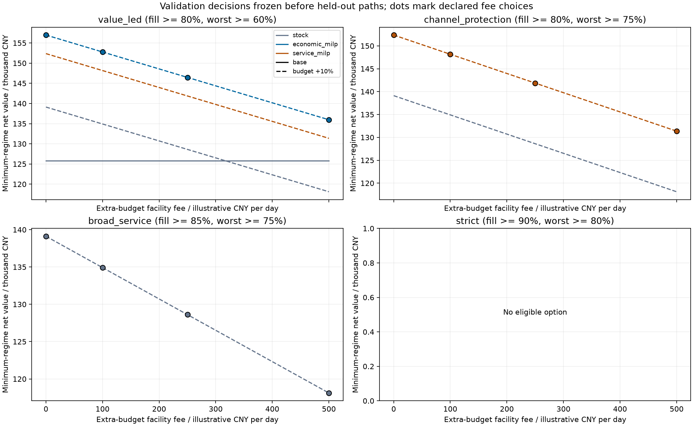

# Service mandates determine the controller; resource bounds determine escalation

[Protocol](decision_study_protocol.md) · [Frozen choices](../results/decision_study/2026-10-27/selection.json) ·
[Held-out assessment](../results/decision_study/2026-10-27/decision_assessment.csv) ·
[All policy means and intervals](../results/decision_study/2026-10-27/test_summary.csv).

The supported result is a conditional decision rule for a synthetic network:
economic MILP, service-priority MILP and a simple stock controller serve different
service mandates. There is no universally superior controller. Specify service
requirements and the cost of procurement resources before choosing an algorithm.

## 1. Three service mandates lead to three different choices

An option must meet both service means in every validation regime and satisfy
the solver-quality gate. Among eligible options maximize the minimum regime
mean economic value less the extra-budget facility fee. This criterion expresses
caution about unknown regime probabilities, not a new robust optimization
algorithm. The same selected option operates across all regimes.

These **validation-frozen choices** confirm on 12 new paired test seeds per regime
at each declared fee of 0 / 100 / 250 / 500 illustrative CNY per operating day.
All selected options use the procurement cap +10%. Values below precede the
facility fee; actual procurement is already charged in the economic ledger.

| Mandate: aggregate / episode-worst-channel mean | Frozen controller | Lowest test aggregate mean across regimes | Lowest test worst-channel mean across regimes | Minimum-regime test value, illustrative CNY |
|---|---|---:|---:|---:|
| 80% / 60% | Economic MILP | 83.07% | 66.45% | 154,645 |
| 80% / 75% | Service-priority MILP | 82.96% | 80.06% | 149,912 |
| 85% / 75% | Stock, review 4 / buffer 0 | 87.11% | 83.64% | 138,443 |
| 90% / 80% | No eligible option | — | — | — |

Both service and solver quality confirm every selected option on held-out means.
The 85%/75% stock choice is the only eligible option among the six tested
controller/resource combinations, not a globally optimal policy. At fee 500,
subtract 42 × 500 = 21,000 from each selected option's value. The study has no
outside option of stopping operations or buying service elsewhere.

For 80%/60%, economic MILP exceeds its frozen runner-up, expanded-budget service
MILP, by 4,733 CNY in minimum-regime test value (paired bootstrap 95% interval
[4,136, 5,319]). For 80%/75%, service MILP exceeds expanded-budget stock by
11,468 CNY ([10,314, 12,756]). Fees cancel within these same-resource pairs.
Intervals are conditional on validation choices, not selection-adjusted guarantees.



## 2. Protecting weak channels differs from raising aggregate service

Under budget +10%, service priority versus economic MILP changes held-out means:

| Regime | Worst-channel change | Paired 95% interval | Economic-value change | Paired 95% interval |
|---|---:|---:|---:|---:|
| Surge | +12.78 percentage points | [11.05, 14.51] pp | -4,614 CNY | [-5,587, -3,642] |
| Supply shock | +14.72 percentage points | [13.23, 16.22] pp | -4,733 CNY | [-5,438, -4,029] |

Aggregate fill changes by -0.11 / +0.19 percentage point. Cumulative-service
priority reallocates shortages across channels; it does not remove a procurement
shortage. At 85% aggregate service, stock qualifies while both MILPs fail that
threshold. This supports choosing the simpler controller for that mandate.

These are observed policy trade-offs, **not a minimum economic cost of channel
protection**. Forecasts, finite horizons, planning gaps and a restricted candidate
set prevent that stronger interpretation.


## 3. Budget value has uncertainty, not a universal cutoff

Under 80%/60%, validation qualifies base stock and expanded-budget economic MILP
as the best options within their resources. Their validation switch fee is
741.26 CNY/day. That point estimate is **not precisely reproduced**: the frozen
pair's held-out gross robust-value premium is 654.90 CNY/day, bootstrap 95%
interval [598.77, 707.40]. Do not use 741.26 as a validated operational cutoff.

At the predeclared maximum fee of 500/day, expanded-budget economic MILP still
exceeds base stock by 6,506 CNY per 42-day episode in robust net value, interval
[4,148, 8,711]. This supports the choice within the tested fee grid. The difference
includes changing the controller as well as resources; it is not the isolated
marginal value of increasing the cap for an unchanged policy. Pure within-policy
budget contrasts remain in
[paired_effects.csv](../results/decision_study/2026-10-27/paired_effects.csv).

For 80%/75% and 85%/75%, no base option qualifies on validation. There is no
supported base-versus-expanded switching fee for these mandates. This means a
missing feasible alternative, not unlimited willingness to pay. Fees are
hypothetical facility-access costs, not observed bank interest.

## 4. Strict service needs resources and a better executable policy

The ex-post LP sees future demand and removes timing, lane and warehouse-handling
restrictions, retaining initial stock, arriving supplier totals and pooled
procurement resources. The physical model has no storage-volume cap. Aggregate
and worst-channel upper bounds are separate necessary feasibility conditions.

- On the 12 surge test paths, current-budget aggregate-fill upper bounds average
  **86.54%**; the largest is 89.90%. A 90% empirical aggregate mean is excluded
  even for an optimistic relaxed controller.
- Budget +10% raises the mean upper bound to **91.39%**. This removes that
  necessary-resource exclusion but establishes no executable solution.
- A post-freeze LP minimizes the common cap multiplier for the 90%/80%
  **empirical mean** mandate. Its surge optimum is **1.071338**: budget must
  increase **at least 7.13%** even in this relaxation. Logistics may require
  more. This is a necessary lower bound, not a sufficient expansion prescription.
- At +10%, all three tested controllers still miss the strict aggregate target
  in surge. Resource expansion alone does not complete the decision problem.
  This experiment does not isolate the remaining effects of timing/handling,
  forecasts and controller design.

For 85%/75%, the pooled surge resource diagnostic requires only multiplier
0.968101, while none of the base-budget candidates qualifies. A relaxation
passing the target does not prove physical feasibility; candidate failure is
also not a resource impossibility proof.
[Necessary-budget lower bounds](../results/decision_study/2026-10-27/necessary_budget_lower_bound.csv)
were added after validation froze and never enter policy selection.

## 5. Mean service confirmation does not certify an SLA

Expanded-budget stock fails the 85%/75% mandate in 1 of 12 surge episodes despite
passing the mean gates. Its exact one-sided 95% upper failure-probability bound
is 33.87%. Even 0 failures in 12 gives 22.09%. This does not certify a requirement
that at least 90% of future episodes pass. Per-metric intervals are unadjusted;
the reported comparisons are correlated and are not independent discoveries.

## Evidence and reproduction

- Protocol source committed at `2bf9a77` before validation: 108 validation
  episodes (6 seeds), then 216 test episodes (12 new seeds), each 42 days.
  Shared policy/resource paths mean 324 episodes are not 324 independent draws.
- All daily records retained: 4,536 validation and 9,072 test rows, plus 540 /
  1,080 channel records. Maximum ledger reconciliation error is 5.82e-11.
  Regenerated demand hashes match all paired cells.
- All 3,024 test service days submit a checked feasible refinement start;
  refinement never worsens its planning economic objective. No fallback occurs.
  Economic precision fails on 9 service days; primary precision on 7. All
  selected options pass the predeclared per-regime quality gates.
- 2,201 service-primary days are not proved exactly optimal; 40 service days
  have a phase time limit. Tolerance satisfaction differs from exact optimality.
  Economic certificates mean <=2% relative **or** <=25 illustrative CNY absolute
  in a forecast planning problem, not a bound on realized policy performance.
- 72 tests pass on Python 3.12 and 3.14: independent small optima, service deficit,
  incumbent preservation, decision gates, fee switches, frozen testing and
  analytic resource bounds.

```bash
python -m unittest discover -s tests -v
python scripts/verify_decision_evidence.py --run-dir results/decision_study/2026-10-27
# Expensive independent rerun; use a fresh directory:
python -m supplychain.decision_study --stage run --output results/decision-study-new
python scripts/decision_diagnostics.py --run-dir results/decision-study-new
python scripts/verify_decision_evidence.py --run-dir results/decision-study-new
```

The fast verifier checks stored evidence and recomputes decisions; it does not
rerun every MILP. The manual `Inventory frozen policy-resource decisions` workflow
does run a fresh simulation. Wall-clock limits can change incumbents on other
hardware. Earlier studies reproduce at their recorded source commits.

Limits: one synthetic network, uncensored past demand, illustrative economics
and fees, three fixed controllers, finite-horizon salvage, forecast-conditioned
decisions, small seed samples, no deployment evidence. The contribution is
model-based decision analysis, not a new optimization algorithm, industrial
scalability or realized business savings.
