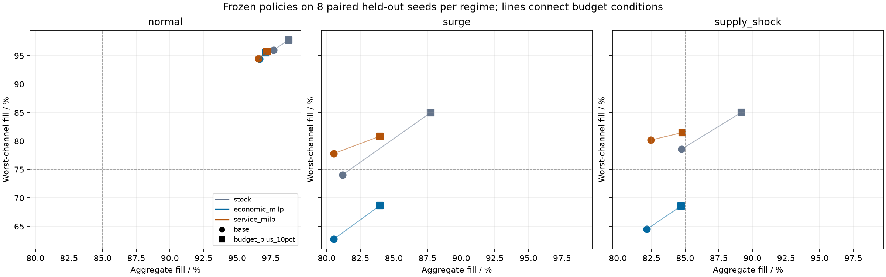
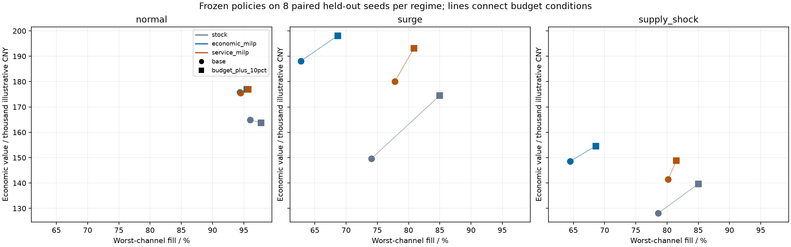

# Cumulative service priority and procurement budget — 2026-10-27

[Protocol](service_budget_protocol.md) · [Frozen selection](../results/budget_service/2026-10-27/selection.json) ·
[Test summary](../results/budget_service/2026-10-27/test_summary.csv) ·
[Paired effects and intervals](../results/budget_service/2026-10-27/paired_effects.csv) ·
[Ledger attribution](../results/budget_service/2026-10-27/ledger_attribution.csv).

This follow-up adds observed cumulative channel service to rolling MILP and
crosses the policy change with a 10% procurement-budget increase. It quantifies
an observed service/economic trade-off under bounded solver time, not a minimum
economic price of fairness or a new optimization algorithm. All demand, costs and
resource scenarios are synthetic.

## Executed design and development repair

The completed study contains 120 validation policy episodes on seeds 31001–31004,
followed by 144 held-out policy episodes on seeds 40001–40008. Each lasts 42 days.
Controls are fixed from prior development: stock review=4/buffer=0 and economic
MILP buffer=0.8/planning penalty=32. Validation selects only the service controller's
gap tolerance from 0/0.02/0.05, globally across both budgets and all three regimes.
Eight paired test seeds per regime support the reported unadjusted 95% t intervals.
Policy/resource cells share paths; 264 episodes are not 264 independent demand draws.

A prior 45-episode incomplete runtime pilot is separately archived under
`results/development/service_budget_runtime_pilot/`, with source commit `a05f122`.
Those inspected paths were reclassified as development and excluded from final
validation/testing. A single development probe showed primary gaps already below
0.0678 percentage point while the solver continued seeking a tighter result.
Declaring 0.1-percentage-point primary precision reduced that probe's mean decision
time from 1.1202 to 0.5340 seconds. This is a single-path diagnostic, not a general
speed benchmark. The final controller is assessed on fresh paths below.

Validation chose tolerance 0.02. Its minimum aggregate fill across all budget/regime
cells was 79.57%, with mean episode-worst-channel fill at least 77.06%. It was
therefore **validation-ineligible** for the 85%/75% selection target and retained
under the declared minimum-deficit fallback. Held-out results do not retroactively
alter this label or select a replacement policy.

## Service changes at the same budget

Differences below are service-priority minus economic MILP on the same paths:

| Budget | Regime | Worst-channel fill change | Paired 95% interval | Economic-value change | Relative value change |
|---|---|---:|---:|---:|---:|
| current | surge | +15.03 percentage points | [12.38, 17.68] pp | -8,065 CNY | -4.29% |
| current | supply shock | +15.66 percentage points | [13.55, 17.77] pp | -7,212 CNY | -4.85% |
| +10% | surge | +12.20 percentage points | [8.56, 15.84] pp | -4,972 CNY | -2.51% |
| +10% | supply shock | +12.90 percentage points | [11.53, 14.26] pp | -5,689 CNY | -3.68% |

The economic-value difference intervals are respectively [-9,938, -6,192],
[-9,074, -5,350], [-6,386, -3,558] and [-7,044, -4,333] illustrative CNY.
Normal-demand value/service intervals generally include zero; no broad improvement
is established there. Aggregate fill is nearly unchanged between the two MILPs:
under current resources it changes by -0.005 percentage point in surge and +0.294
percentage point in supply shock. Protecting weak channels does not establish a
large aggregate service gain.

All panels share axes. Circles are current budgets, squares are budgets +10%, and
lines join the same frozen policy under the two budgets. Dashed lines show the
85% aggregate/75% worst-channel evaluation thresholds. Complete episode violation
rates and intervals remain in CSV; points are means, not service guarantees.

## Budget effects depend on policy and regime

The following changes compare the same policy at +10% versus current budget:

| Policy | Regime | Economic-value change | Aggregate fill change | Worst-channel fill change |
|---|---|---:|---:|---:|
| stock | surge | +24,793 CNY | +6.53 pp | +10.90 pp |
| economic MILP | surge | +9,959 CNY | +3.44 pp | +5.89 pp |
| service MILP | surge | +13,052 CNY | +3.45 pp | +3.06 pp |
| stock | supply shock | +11,613 CNY | +4.45 pp | +6.46 pp |
| economic MILP | supply shock | +5,939 CNY | +2.55 pp | +4.08 pp |
| service MILP | supply shock | +7,463 CNY | +2.34 pp | +1.31 pp |

For service MILP, surge value change has paired interval [11,124, 14,981] CNY and
supply-shock change [4,460, 10,465] CNY. Normal-demand budget-value intervals
include zero for all policies; more purchasing flexibility is not a universal
economic improvement. The service-versus-economic budget interaction in surge
is +3,093 CNY [2,012, 4,174], narrowing the observed service-priority value penalty.
Its supply-shock counterpart is uncertain: +1,523 CNY [-596, 3,642]. These are
exploratory multiple comparisons, not confirmatory general effects.

The tuned stock controller at the larger budget meets the **mean** 85%/75% target
in all test regimes, while service MILP remains below 85% aggregate fill in both
stress regimes (83.97% surge, 84.79% supply shock). Even stock violates that target
in 2/8 surge episodes. Service MILP therefore does not dominate the strong stock
baseline or satisfy the full mandate. Choosing among these controllers from test
outcomes would require fresh validation before a prospective claim.

Economic values are synthetic, after actual procurement and operating ledger costs.
The budget cap itself has no modeled financing/reservation fee. Descriptive
`budget_value_per_day.csv` rescales the paired value changes into illustrative
break-even daily fee ceilings; it is not actual credit pricing or risk-adjusted ROI.

## Accounting interpretation

At current budget in surge, the -8,065 CNY service-policy value difference decomposes
mainly into -6,061 revenue, -835 shortage-penalty contribution, -715 terminal-salvage
contribution and other transport/dispatch/holding/purchase terms. Additional actual
procurement is only 133 CNY on average. In supply shock, revenue contributes -3,834
CNY and additional freight/dispatch costs together contribute -1,822 CNY. These
accounting identities support interpretation of sales mix and delivery costs;
they are not independent causal estimates of those mechanisms. Every paired
seed's contribution sum is checked against its economic-value difference.

## Resource limits and solver reliability

On these fresh test paths, current-resource optimistic aggregate fill bounds are
86.80% in surge and 92.48% in supply shock. Budget +10% raises the bounds to 91.66%
and 97.58%. Distribution timing, network capacities and integrality are relaxed.
The strict 90% mean surge target remains impossible under current procurement
resources on these paths; passing the enlarged-budget bound does not prove an
implementable policy meets it.

There are 2,016 service-policy decision days. All reported primary incumbent/bound
gaps meet the declared 0.001 deficit precision. Exact primary optimality is not
proved on 1,480 days; precision certification and exact proof are different fields.
207 days hit a solver time limit in at least one phase. Economic refinement falls
back to the checked service incumbent on two days; physical stock fallback is not
needed. All realized economic identities reconcile within 5.82e-11 illustrative CNY.

The largest recorded economic planning MIP gap is 1.4307 (143.07%), so economic
refinement quality is not uniformly within its requested 2% tolerance. This gap
concerns a per-decision planning objective, not the optimality of realized policy
profit. The observed economic loss must not be presented as an unavoidable or
globally optimal price of fairness. Further refinement/warm-start engineering is
needed before claiming a reliable economic frontier.

Service-policy mean model-build/solve times range from 0.084 to 0.475 seconds across
cells on this machine. Stock's solver-time field is conventionally zero because
its heuristic has no solver; it is not a measured zero full-controller latency.
All 53 tests passed on Python 3.14.7 and 3.12.14, including independent allocation
enumeration, historical-prefix causality, either-stage failure, precision versus
exactness, frozen partitions, altered evidence and factorial accounting checks.

## Remaining research decisions

Use a service mandate to choose the appropriate trade-off; retain the stock
baseline. Improve economic refinement reliability and distinguish objective
preference from solver approximation. Separately perturb warehouse throughput,
transport resources and timing before attributing the enlarged-budget service gap
to a specific downstream bottleneck. New policy choices after inspecting these
tests require fresh paths or an explicit post-hoc label. Real uncensored demand,
actual resource/financing costs, multiple networks and industrial-scale validation
remain absent.
