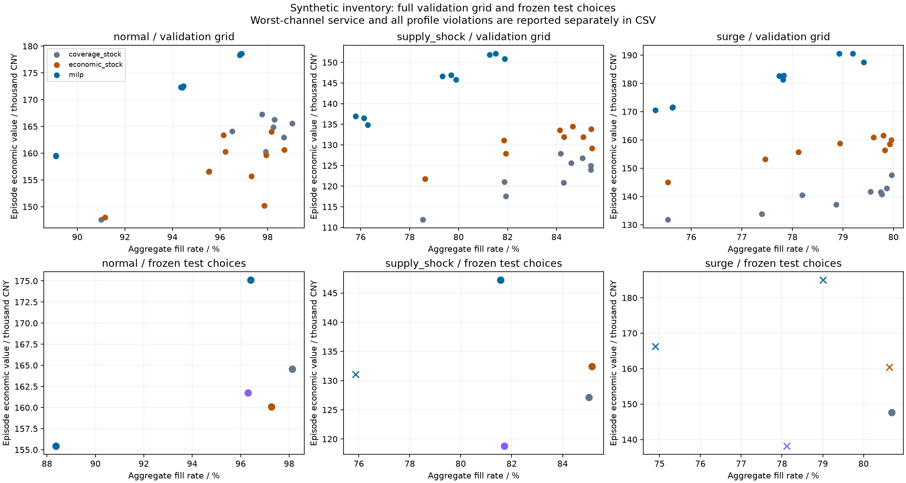

# Service-target study — 2026-10-27

This extension compares validation-selected policies on independent synthetic
demand paths and diagnoses necessary resource limits. It changes the strength of
the baseline and the quality of evidence, not the empirical status of the project.
There is no demonstrated general MILP advantage at comparable service.

[Declared protocol](service_frontier_protocol.md) ·
[Frozen choices](../results/service_frontier/2026-10-27/selection.json) ·
[All test results](../results/service_frontier/2026-10-27/test_summary.csv) ·
[Paired differences](../results/service_frontier/2026-10-27/paired_comparisons.csv) ·
[Resource bounds](../results/service_frontier/2026-10-27/CAPACITY_BOUNDS.md).

## What was executed

Nine configurations each for coverage stock, contribution-priority stock and
five-day rolling MILP were evaluated on six validation seeds in three regimes:
486 policy episodes. Choices for three declared service profiles were then frozen.
Five unique selected/control configurations were evaluated on twelve new test
seeds and three regimes: 180 policy episodes. All episodes have 42 operating days.
The resulting 666 policy simulations are paired, not 666 independent demand paths.
Profile reuse is not counted as extra simulation evidence.

Each family retained its own natural planning/coverage convention. The comparison
does not isolate a solver effect. The contribution-priority heuristic intentionally
ignores joint fixed-charge batching; it is a specified competing heuristic, not an
optimal greedy algorithm. Candidate counts are equal; tuning CPU budgets differ.

The 38-test suite passed on Python 3.14.7 with the existing lock file and on
Python 3.12.14 with compatible numeric dependencies. The legacy
four-policy normal-demand seed-101, 21-day economic values equal their committed
references exactly. This is a limited default-behavior regression, not a rerun of
the entire legacy 144-episode study. New held-out test simulations recorded zero
fallback and zero time-limit days; maximum ledger identity error was 5.82e-11 CNY.

## A stronger simple baseline changes the comparison

Coverage stock with review=4 and no forecast buffer was selected for all profiles
by the declared minimum-deficit fallback. It increased value and both reported
service measures over the legacy review=2 control on the held-out paths:

| Regime | Economic-value change | Paired mean change / illustrative CNY | 95% paired interval / CNY | Aggregate fill change | Worst-channel fill change |
|---|---:|---:|---:|---:|---:|
| normal | +1.73% | +2,802 | [1,408, 4,196] | +1.84 percentage points | +2.77 percentage points |
| surge | +6.89% | +9,522 | [7,270, 11,773] | +2.57 percentage points | +3.82 percentage points |
| supply shock | +7.02% | +8,335 | [6,615, 10,054] | +3.31 percentage points | +5.82 percentage points |

These are retrospective within-simulator observations, not operating savings.
Intervals are exploratory and unadjusted across multiple comparisons. Improving
the control does not mean the selected baseline meets the declared service mandate.

## Higher MILP value still comes with service trade-offs

The relaxed-profile MILP selected buffer=0.8 and planning service penalty=32.
The following table shows all three regimes, including target failures:

| Regime | Policy | Economic value / illustrative CNY | Aggregate fill | Mean episode-worst-channel fill |
|---|---|---:|---:|---:|
| normal | Tuned coverage stock | 164,544 | 98.13% | 97.20% |
| normal | Buffered MILP | 175,092 | 96.41% | 94.21% |
| surge | Tuned coverage stock | 147,655 | 80.69% | 72.49% |
| surge | Buffered MILP | 184,965 | 79.01% | 60.89% |
| supply shock | Tuned coverage stock | 127,106 | 85.02% | 80.17% |
| supply shock | Buffered MILP | 147,208 | 81.56% | 64.12% |

None of the nine tuned family/profile combinations passed its service gates in
every validation regime. They remain labeled ineligible; no targets were relaxed
after seeing outcomes. Even the relaxed aggregate target of 80% was narrowly missed
by the best coverage candidate in validation (79.96%). Its test aggregate mean
exceeded 80%, but that does not retroactively make it validation-eligible. The
relaxed-profile tuned stock policy still violated either target in 5/12 surge
episodes. Mean service is not a per-episode guarantee.

All 27 reported family/profile/regime comparisons fail the declared comparison
qualification, so none supports a qualified MILP economic-superiority claim.
The balanced/strict profiles select a different, unbuffered minimum-deficit MILP;
these additional negative results remain in the complete CSV/report.

Colors: grey coverage stock, orange contribution-priority stock, blue MILP,
purple legacy stock. Bottom panels deduplicate configurations reused across
profiles; circle/cross indicates the mean-service check for the first reported
profile of that configuration. The plot is descriptive; full profile checks,
worst-channel service and episode violations are in CSV. Axis ranges differ by
regime and row; compare the labeled numeric coordinates, not point heights across panels.

## Procurement resources rule out the strict surge target

Independent LP diagnostics see realized demand after choices are frozen and
relax distribution timing, warehouse/lane limits and integer quantities. They
retain initial stock, arriving procurement quantity and procurement budget.
These are optimistic ex-post bounds, not feasible executable policies.

| Purchasing-resource scenario | Normal aggregate upper bound | Surge aggregate upper bound | Supply-shock aggregate upper bound |
|---|---:|---:|---:|
| Current resources | 100.00% | 86.50% | 92.16% |
| Budget +10% | 100.00% | 91.35% | 97.08% |
| Supplier capacities +10%, rounded down | 100.00% | 87.87% | 92.48% |

The strict profile requires 90% mean aggregate fill in every regime. The optimistic
surge upper bound of 86.50% rules this out on these fixed held-out paths even for
a clairvoyant relaxed controller. This necessary resource limitation cannot be
repaired by tuning allocation alone. The relaxed and balanced targets are not
ruled out by the separate bounds; their implementability remains unresolved.

Raising budget by 10% lifts the relaxed surge bound above 90%, but does not prove
that any implementable policy reaches it. Supplier expansion alone by this amount
still leaves that bound below 90%. The experiments concern relaxed bounds; they
do not estimate actual expansion profit or justify a capital investment.

## Next research decision

Prioritize a procurement-budget/service feasibility study and a channel-service
allocation mechanism before expanding the algorithm list or making scale claims.
Separate resource changes from policy changes, consider explicit service-deficit
priorities, and retain the stronger stock comparator. Any new specification selected
after inspecting these test outcomes needs fresh validation/test paths, or must
be labeled post-hoc. Actual policy performance under expanded budgets has not yet
been evaluated. Real sales, multi-network generalization and industrial scale
remain unverified.
